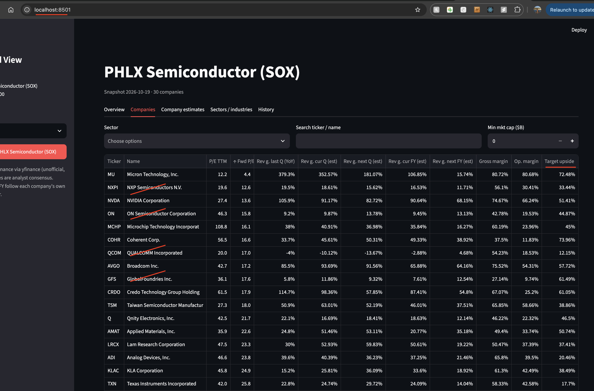

# Forward View

Track valuation (trailing/forward P/E) and analyst consensus estimates (revenue and EPS,
current/next quarter and current/next fiscal year) for SOX, Nasdaq-100, S&P 500 and its Tech Hardware and Energy groups,
with sector/industry aggregates and a history that builds up with every refresh.



## Setup

```bash
python3 -m venv .venv
.venv/bin/pip install -r requirements.txt
```

## Refresh data

```bash
.venv/bin/python -m forwardview.refresh sox ndx      # add spx for the S&P 500 (~5 min), hw, energy
```

Each run stores a dated snapshot in `data/forwardview.db` (SQLite). Running twice on the
same day overwrites that day. Refresh daily or weekly to build the history charts.
You can also refresh from the sidebar button in the app.

## Scheduled refresh (launchd)

`scripts/refresh.sh` refreshes all universes and logs to `logs/refresh.log`.
The launchd job `com.forwardview.refresh` runs it Tue-Sat at 07:00 local time (after the
Mon-Fri US closes). If the Mac is asleep at 07:00, the job runs when it wakes.

```bash
# install (after editing scripts/com.forwardview.refresh.plist)
cp scripts/com.forwardview.refresh.plist ~/Library/LaunchAgents/
launchctl bootstrap gui/$(id -u) ~/Library/LaunchAgents/com.forwardview.refresh.plist

launchctl kickstart gui/$(id -u)/com.forwardview.refresh   # run now
launchctl bootout gui/$(id -u)/com.forwardview.refresh     # uninstall
```

The plist uses absolute paths; update them if the project folder moves.

## Run the dashboard

```bash
.venv/bin/streamlit run app.py
```

## Notes

- Data source: Yahoo Finance via `yfinance` (free, unofficial; can break or rate-limit).
- Constituents: SOX from the Nasdaq index site (fallback list in `universes.py`),
  Nasdaq-100 from the Nasdaq API, S&P 500 from Wikipedia. `hw` and `energy` are S&P 500
  members filtered by GICS (Technology Hardware & Equipment sub-industries; Energy sector).
- "agg" figures are market-cap weighted, index style: total market cap / total earnings,
  total estimated revenue / total base revenue. Medians show the typical company.
- Current/Next FY follow each company's own fiscal calendar (NVDA's FY ends in January).
- FY+2 and later estimates are not in Yahoo's free data; they come from FMP, with Nasdaq.com as fallback (see below).

## FY+1 ... FY+4 estimates (FMP)

Copy `.env.example` to `.env` and set `FMP_API_KEY`. Then:

```bash
.venv/bin/python -m forwardview.estimates sox ndx hw energy
```

Annual revenue/EPS consensus is stored in the `estimates` table and shown in the
"FY+1 – FY+4" tab and in "Company estimates". FY0 is the current, not yet reported fiscal
year. Tickers fetched within the last 7 days are skipped (`--max-age`), and a run stops
after 200 calls (`--max-calls`), to stay inside the free plan's 250 calls/day.
The free plan covers only a small sample of large symbols. For the rest, annual EPS consensus
(FY0 ... FY+3, no revenue) comes from Nasdaq.com (Zacks data, free, no key). FMP rows whose EPS
is in another currency than the US listing (e.g. TSM in TWD) are replaced with Nasdaq data too.
